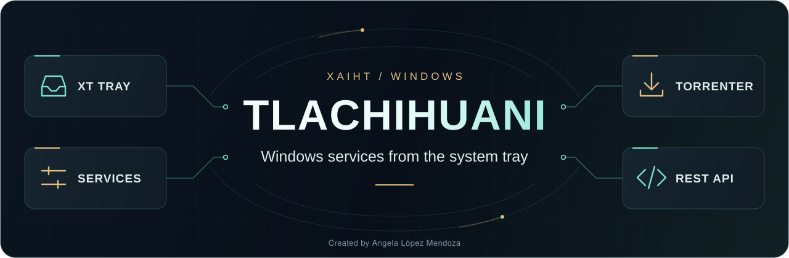

<!-- Tlachihuani — Created for Angela López Mendoza · XAIHT · @angelahack1 -->

<p align="center">
  
</p>

<h1 align="center">Tlachihuani</h1>

<p align="center">
  <b>Start your Windows services from the XT tray. Follow your downloads in Tlamatini.</b><br />
  Tlachihuani runs background jobs independently of your browser and chat windows.
  Torrenter is its first provider.
</p>

<p align="center">
  <a href="docs/releases/v0.38.0.md"></a>
  <a href="#installation"></a>
  <a href="packaging/setup/README.md"></a>
  <a href="#build-from-source"></a>
  <a href="docs/torrenter.md"></a>
</p>

<p align="center">
  <b>Current pre-release: <a href="docs/releases/v0.38.0.md">v0.38.0</a></b><br />
  <b>Resilient torrent queues · Sortable workspace · Verified file delivery</b><br />
  Offline installer &amp; uninstaller · Optional XT at sign-in · Desktop shortcut · Control Panel removal
</p>

<p align="center">
  <a href="docs/releases/v0.38.0.md">What's new in 0.38.0</a> ·
  <a href="#installation">Install &amp; uninstall</a> ·
  <a href="packaging/setup/README.md">Package guide</a> ·
  <a href="#first-download">First download</a> ·
  <a href="#tray-controls">Tray controls</a> ·
  <a href="#documentation">Documentation</a>
</p>

> [!TIP]
> **Already installed?** Right-click **XT → Start Services**. When the icon turns color, open **Panels → Torrenter Workspace** in Tlamatini to see the downloads for your signed-in account.

If XT is missing after setup, open **Tlachihuani XT** from Start or press **Win+R** and run `"C:\Program Files\XAIHT\Tlachihuani\Tray\Tlachihuani.Tray.exe" --show`. The overview can show **Stopped** on first launch. Right-click the gray XT icon beside the clock (check the hidden icons), then choose **Start Services**. The [local health endpoint](http://127.0.0.1:12064/api/v1/health) should return `{"api_version":1,"engine":"ready"}`.

## Send a real prompt from your phone

Open **xaiht.org → Tlamatini-RC**, choose your computer, then select the ready
Tlamatini account approved in **XT → Services → xaiht.org → Accounts…**. Prompts
and answers use the existing outgoing HTTPS connection. Start Tlamatini and
Remote-Controller on the PC first. Refresh keeps the existing conversation.

Ask Execs requests approval for selected protected operations, not every tool;
Monitor Netstat is a read-only exception. See [setup and privacy](docs/xaiht-link.md)
and the [actual phone acceptance record](docs/verification/2026-11-23-hosted-prompts.md).
The website relay is not end-to-end or post-quantum encrypted.

## First download

1. **Open your workspace.** Use the Tlamatini menu above, or choose **Open workspace** in XT. XT always shows the Tlamatini login page first, so the queue that opens belongs to the account you sign in with, even if the browser was signed in with another one. If both Tlamatini editions are available, choose the edition, then sign in.
2. **Pick what to download.** Select **Add torrent**, paste a magnet or open a `.torrent` file, then choose **Inspect metadata**. Jobs can look up four magnets at once. Additional magnets wait in order, and their peer timeout starts when a slot opens.
3. **Start the transfer.** Choose the files you want and select **Download selected files**. You can close the browser or Tlamatini while the Jobs service continues downloading.
4. **Find your files.** Select the completed transfer and open **Verified output** for its saved directory and each file’s SHA-256. The usual destination is **Downloads → Torrenter**. If Windows refuses delivery there, check Verified output for the application’s `content_generated` fallback.

## What's new in 0.38.0

- **One verbose log for everything.** XT, the three services, the Torrenter
  engine, setup and the scripts write a trace log of every statement, request and
  error. XT copies the services' lines into Tlachihuani.log, so
  **Services → See log** shows the whole computer in one place. Secrets are masked.
- **Quiet while idle.** A polling loop writes a pass only when it differs from the
  previous one, so an idle Tlachihuani adds one line per loop every ten minutes.
  See the [0.38.0 notes](docs/releases/v0.38.0.md).

### Carried forward from 0.37.0

- **Messages from xaiht.org.** Connect this computer to the **Tlamatini-RC** page
  on xaiht.org from **Services → xaiht.org**. The page shows the computer online
  from any network, and a message sent with **SEND** arrives as JSON in XT's log.
  No port is opened. See the [xaiht.org link guide](docs/xaiht-link.md).
- **Tlachihuani.log and See log.** XT keeps its own log and shows it from
  **Services → See log**. See the [0.37.0 notes](docs/releases/v0.37.0.md).

### Carried forward from 0.36.0

- **Remote-Controller.** A third service, `Tlachihuani.RemoteController`, hosts
  the Tlamatini-RC web client with per-account permissions granted in XT, and
  approvals stay synchronized across both main editions and RC. See the
  [0.36.0 notes](docs/releases/v0.36.0.md).
- **A workspace that is always yours.** XT's **Open workspace** now opens the
  Tlamatini login page first, even if the browser is already signed in, so the
  queue shown belongs only to the account that just signed in.

### Carried forward from 0.3.3

- **A queue that keeps moving.** An unfinished transfer with no payload progress
  for 180 seconds yields its slot when another eligible download is blocked.
  Partial files remain; retry waits at least 60 seconds. Paused and stopped jobs
  keep the user's intent.
- **Clear recovery actions.** Start resumes an incomplete stopped job, Resume
  continues a paused one, and Recheck validates retained pieces after a failure.
  Completed files remain completed when their peer session stops. Historical
  errors are distinguished from current failures and delivery errors.
- **A workspace you can organize.** Sort all twelve data columns, combine filters
  and search, choose columns and row density, and save a separate view per account.
  Mixed selections apply controls only to eligible downloads.
- **Verified delivery.** Jobs waits for disk writes to finish before hashing.
  Verified output shows the actual saved path and SHA-256. Session reads recover
  from truncated responses without replaying download commands.

The [release notes](docs/releases/v0.3.3.md) distinguish tested source behavior
from package acceptance. The dated checks include 64 automated checks, 48 visible
browser checks and four real local-peer transfers. Updating Jobs and the matching
Tlamatini clients activates their respective changes.

## Tray controls

The current source also includes **Tlachihuani-RC Server**, managed independently
as **Remote-Controller** from the Services panel. It contains the live RC client,
local device enrollment, sessions, receipts and schedules. Both main Tlamatini
editions now have source integration for account activation, real chat, execution
approvals and cancellation; XT supplies the installed-application launch broker.
Network connections, voice and final installed acceptance remain gated; see the precise
[implementation boundary](docs/remote-controller.md) and
[13 November verification](docs/verification/2026-11-13-remote-controller.md).
RC is Manual/stopped at installation, joins Start Services only by explicit opt-in,
and is included in Stop Services. Torrenter remains its own Jobs plane.

| What you want to do | Where to go | What happens |
| :--- | :--- | :--- |
| Bring Torrenter online | **XT → Start Services** | The icon turns color when the services and API are ready. |
| Check a slow download | **XT → Show panel → Services…** | Inspect Jobs, engine and web readiness. Open the workspace for the transfer’s progress, trackers and peers. |
| Stop background work | **XT → Stop Services** | The services and their workers stop. The gray XT icon stays available to start them again. |
| Read XT's log | **XT → Show panel → Services… → See log** | Tlachihuani.log opens inside XT and follows new lines, including messages from xaiht.org. |
| Receive messages from xaiht.org | **Services… → xaiht.org → Connect…** | Paste the key from xaiht.org → Tlamatini-RC. See the [xaiht.org link guide](docs/xaiht-link.md). |
| Chat with running Tlamatini from a phone | **Services… → xaiht.org → Accounts…** | Approve the exact English or Spanish account, then select it on the website. Real answers, cancellation and execution approvals use the existing chat engine. See [account setup](docs/xaiht-link.md#allow-an-account-and-send-a-real-prompt). |
| Close only the tray | **XT → Exit tray** | The icon disappears. If a service is running, the menu reads **Exit tray (service keeps running)**. |

> [!NOTE]
> **Remove record** keeps the downloaded files. To delete the files themselves, choose **Erase files…**, review the exact files and approve the operation in XT.

## Installation

Use **Windows 11 x64**. The download includes private .NET and Python runtimes; no SDK or separate runtime installation is required. The current setup source defines three independent services: `Tlachihuani` reports lifecycle and health, `Tlachihuani.Jobs` hosts Torrenter, and `Tlachihuani.RemoteController` hosts the RC server. The XT tray runs in the signed-in Windows session. See the [RC verification record](docs/verification/2026-11-13-remote-controller.md) for the distinction between the built package and final installed acceptance.

### Install with the Windows wizard

1. Get the matching **Tlachihuani-0.38.0-windows-x64.zip** from your distributor. Right-click it → **Extract All**, then open **START-HERE.html** for the offline illustrated guide. Confirm **0.38.0** in the installer before proceeding. If an earlier version is installed, [uninstall it](#uninstall-and-keep-your-downloads) first; your downloads stay. The release command produces the ZIP in `dist\`.
2. Sign in as the Windows user who will operate XT. Open **Installer.exe** and choose whether **XT should appear at Windows sign-in**. This choice applies to all Windows users on the PC. Select **Review**, check the version, operator, destination and startup choice, then choose **Install** and approve Windows' administrator prompt.
3. After **Installation complete**, XT appears gray in your normal Windows session. Check the hidden-icons arrow beside the clock. **Start menu and Desktop shortcuts** always let you reopen it. If the entire wizard was launched as administrator, open XT from either shortcut yourself.
4. Choose **Start Services** only when needed. Both services remain **Stopped / Manual** after installation and reboot. Login opens XT only when you selected that option; it never starts services or downloads. With the option unchecked, open XT manually after signing in.

### Uninstall and keep your downloads

1. In XT, choose **Stop Services**, wait for the icon to turn gray, then choose **Exit tray**. Close XT in other signed-in sessions too.
2. Open **Control Panel → Programs → Programs and Features → Tlachihuani → Uninstall**. Windows **Settings → Apps → Installed apps** and **Uninstall Tlachihuani** in Start provide the same registered removal. The matching **Uninstaller.exe → Review → Uninstall** is also included. Approve the Windows prompt.
3. Your delivered files and the protected Jobs state stay on disk. Reinstall with the same Windows operator to reuse the retained identities and journal. If the wizard requests a restart, restart Windows before reinstalling.

**Already installed with PowerShell?** Those installations use a separate maintenance path. Follow the [Windows packaging guide](packaging/windows/README.md) for the primary service and the [Jobs operating guide](docs/torrenter.md#windows-installation) for Jobs. The wizard refuses to take ownership of a legacy installation.

See the [setup guide](packaging/setup/README.md) for prerequisites, recovery, logging and visible acceptance tests.

### Build from source

**Create the complete distributable from Command Prompt at the repository root:**

```bat
Build-Release.cmd
```

Or run `.\Build-Release.cmd` in a visible PowerShell console. Each run reads the highest numeric local `vX.Y.Z` release tag, stamps the product and internal project references, rebuilds the four components and installer, and verifies the package before writing **`dist\Tlachihuani-<version>-windows-x64.zip`** and **`.zip.sha256`**. Upload those two files to your GitHub Release. The script never commits, creates tags or uploads anything.

The current checkout, including local edits, supplies the code; the tag supplies its version. Keep your local tags current. Prerelease tags are ignored, and a highest release tag outside the checkout's history stops the build. Fresh staging prevents old published files from leaking into a new ZIP. Build logs and source provenance stay under `artifacts/release-builds/`. See the [release command guide](docs/release-building.md) for prerequisites and acceptance checks.

For **0.38.0**, the builder selects the numeric `v0.38.0` tag by those rules;
GitHub's release flags are separate. A suffixed tag such as `v0.38.0-rc.1` is not
selected by this builder.
Building the ZIP and publishing a release are separate steps.

<details>
<summary><b>Show PowerShell commands and runtime requirements</b></summary>

Use the SDK pinned in [global.json](global.json). Open a visible foreground PowerShell console and keep it open for the results. From the source checkout on this machine, run:

```powershell
Set-Location -LiteralPath 'C:\Development\XAIHT\repo\Tlachihuani'
.\scripts\Build.ps1 -Mode Check
.\scripts\Build.ps1 -Mode Publish
.\scripts\Build-Setup.ps1
.\artifacts\publish\Control\Tlachihuani.Control.exe status
.\artifacts\publish\Tray\Tlachihuani.Tray.exe --show
```

These lower-level commands are for component development. **Check** exercises the lifecycle boundaries. **Publish** produces the four self-contained x64 components under `artifacts/publish/`. **Build-Setup** packages those published bytes. Use **Build-Release.cmd** above for a fresh, verified distributable in `dist`. The current build is unsigned; a publisher certificate is required for Authenticode signing.

</details>

## Documentation

| For operators | For developers |
| :--- | :--- |
| [0.38.0 release notes](docs/releases/v0.38.0.md) · [0.37.0](docs/releases/v0.37.0.md) · [0.36.0](docs/releases/v0.36.0.md) · [0.3.3](docs/releases/v0.3.3.md) | [Torrenter recovery verification](docs/verification/2026-11-10-torrenter-recovery.md) |
| [Torrenter workspace and REST API](docs/torrenter.md) | [Architecture and process responsibilities](docs/architecture.md) |
| [Service lifecycle](docs/lifecycle.md) | [Controller commands and JSON replies](docs/control-protocol.md) |
| [Panel and tray](docs/panel-and-tray.md) | [Tlamatini integration design](docs/tlamatini-integration.md) |
| [Windows privileges and local IPC](docs/security-and-installation.md) | [Implementation status and verification evidence](docs/implementation-status.md) |
| [Remote-Controller (Tlamatini-RC)](docs/remote-controller.md) | [Hosted RC development lab](docs/hosted-development.md) |
| [xaiht.org link and Tlachihuani.log](docs/xaiht-link.md) | [Real prompt verification](docs/verification/2026-11-23-hosted-prompts.md) · [Initial link verification](docs/verification/2026-11-19-xaiht-link.md) |
| [Remote-control predeployment checklist](docs/remote-control-predeployment-checklist.md) | [Workspace sign-in verification](docs/verification/2026-11-17-workspace-signin.md) |

<details>
<summary><b>Under the hood · API, repositories and contributor references</b></summary>

The browser workspace and Tlamatini’s wrapped Torrenter agent use the same account-scoped Jobs API. With Jobs running, [open local API discovery](http://127.0.0.1:12064/api/v1). The native controller handles `status`, `events [--cursor N]`, `start`, `stop` and `restart` for the primary service. The separate **Panels → Tlachihuani** lifecycle panel is a design target. **Panels → Torrenter Workspace** is the implemented download interface.

| Reference | Location |
|---|---|
| This independent project | `C:\Development\XAIHT\repo\Tlachihuani` |
| Tlachihuani on GitHub | [github.com/angelahack1/Tlachihuani](https://github.com/angelahack1/Tlachihuani) |
| Tlachihuani Git origin | `https://github.com/angelahack1/Tlachihuani.git` |
| Tlamatini source checkout | `C:\Development\XAIHT\Tlamatini` |
| Tlamatini Django application | `C:\Development\XAIHT\Tlamatini\Tlamatini` |
| Tlamatini on GitHub | [github.com/XAIHT/Tlamatini](https://github.com/XAIHT/Tlamatini) |
| Verified origin | `https://github.com/XAIHT/Tlamatini.git` |
| Design reference revision | `c18d50815cfe8b1681f805fd4e76c66fbaeabaf6` (`v1.78.0-4-gc18d5081`) |

For the next development session, read [AGENTS.md](AGENTS.md), [CLAUDE.md](CLAUDE.md) and the [session handoff](NEXT_SESSION.md). The [roadmap](docs/implementation-plan.md), [verification plan](docs/verification-plan.md), [project tree](docs/project-tree.md), [source review](docs/source-review.md) and [skill inventory](docs/skill-inventory.md) cover the rest of the checkout. Changes to either repository and publication require their own authorization.

</details>

<p align="center">
  <a href="assets/branding/README.md"></a><br />
  <b>Created by Angela López Mendoza · XAIHT</b><br />
  <a href="https://github.com/angelahack1/Tlachihuani">Tlachihuani</a> · <a href="https://github.com/XAIHT/Tlamatini">Tlamatini</a>
</p>

## Hosted Tlamatini-RC development

The website's **outgoing HTTPS prompt channel** is separate from the development
lab below. Updated XT and Remote-Controller sources deliver typed prompts to a
locally approved, already running Tlamatini account and return real answers.
Diagnostic messages remain inert. The website is trusted with plaintext; this
channel does not claim PQ or end-to-end encryption. See the [connection guide](docs/xaiht-link.md).

The hosted client, cloud relay and service-owned outbound connector have an
isolated HTTPS development profile with English and Spanish interfaces. Use the
[English validation guide](docs/hosted-development.md) or
[guía de validación en español](docs/hosted-development.es.md) to build and test
the browser, real OIDC provider and Linux container.

This profile does not enable Internet access, modify the installed applications
or deploy to xaiht.org. The production encryption and trusted-client gates stay
closed. Torrenter remains independent.
