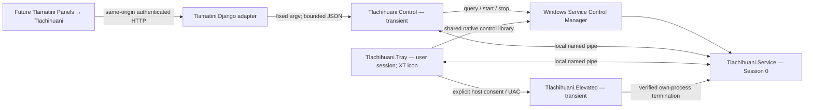

# Architecture

Implementation update: [current status and remaining gates](implementation-status.md) supersede any scaffold-only statements below. This document retains the full planned architecture.

Design proposal, 2026-10-11. No components are implemented.

## Hosted prompt integration · 23 November review

The website path now carries real prompts and answers to an explicitly approved
running Tlamatini account through XT's outgoing HTTPS connection and the local
Remote-Controller adapter. It does not open an inbound port or add website launch,
shutdown or phone-audio controls. Diagnostics remain inert and separate from typed
commands. Retries retain identity, receipts survive reload, and full answers use
validated account-bound chunks. Ask Execs follows the existing selective policy;
Netstat is exempt, whereas the tested Executer action displayed approval.

Physical-phone English prompt/answer, reload and approval display were observed.
Real denial/no-execution and cancellation were not completed before tests stopped.
The wording-only website candidate was built but not promoted. Read the
[current integration guide](xaiht-link.md) and [dated evidence](verification/2026-11-23-hosted-prompts.md) before making
installation or release-acceptance claims. This pass changes documentation only;
existing version identifiers and installed services remain unchanged.

## Process model

The service continues when no browser is open, Tlamatini is closed, the tray exits, or the user logs off. The tray only exists in participating interactive sessions. Windows isolates service UI from the user's desktop; a separate session process is required. This split follows [Microsoft's interactive-services guidance](https://learn.microsoft.com/en-us/windows/win32/services/interactive-services).

## Implemented planes · 1.0.0

The current product runs three independent own-process Windows services and the
per-session XT tray. The installer registers every service **Manual and stopped**,
each under its own virtual account `NT SERVICE\<service name>`.

| Process | Role | Details |
|---|---|---|
| `Tlachihuani` (`Tlachihuani.Service.exe`) | Original lifecycle and health service | [Lifecycle](lifecycle.md) |
| `Tlachihuani.Jobs` | Provider host: Torrenter worker and the account-scoped REST/web facade on `127.0.0.1:12064` | [Torrenter](torrenter.md) |
| `Tlachihuani.RemoteController` (`RCServer/Tlachihuani.RC.Server.exe`) | Tlamatini-RC web client, enrollment, device grants, sessions, receipts, events and schedules; local-only on `127.0.0.1:12481` by default | [Remote-Controller](remote-controller.md) |
| `Tlachihuani.Tray` (XT) | Session tray, Services and Remote-Controller panels, the interactive-session application-launch broker used by RC, Tlachihuani.log with See log, and the xaiht.org link | [Panel and tray](panel-and-tray.md), [xaiht.org link](xaiht-link.md) |
| `Tlachihuani.Tray --flow-pills` (Flow Pills) | A separate per-user window, not a service: opens, draws and runs Tlamatini's `.flw` flows and `.fpmt` flow pills, each run on its own thread and in its own Windows job | [Flow Pills](flow-pills.md) |

Since 0.37.0 XT also receives messages from the **Tlamatini-RC** page on
xaiht.org (the XAIHT `web-app`). XT asks `https://xaiht.org/api/rc/poll` with its
computer key over outgoing HTTPS, writes each JSON message to Tlachihuani.log and
acknowledges it. No Windows service, listening port or firewall rule is involved.
See the [xaiht.org link](xaiht-link.md).

Since 0.38.0 every process writes a statement-level trace log. XT, the control
tools and the setup wizard write `%LOCALAPPDATA%\XAIHT\Tlachihuani\Tlachihuani.log`;
each service writes under `%ProgramData%\XAIHT\<service>\logs` (`service.log`,
`jobs.log`, `web.log`, `torrent.log`, `rc.log`). A service cannot write into the
user's profile, so XT copies the services' new lines into Tlachihuani.log while it
runs. See the [0.38.0 notes](releases/v0.38.0.md).

`Tlachihuani.RC.Cloud` is a separate cross-platform development host (hosted BFF,
computer directory and opaque relay) for the isolated HTTPS loopback lab. It
executes no Tlamatini commands and is not part of the Windows package. See
[hosted development](hosted-development.md).

## Recommended stack

Use C# with .NET 10 for the independent Windows layer: a Worker Service host, native SCM integration, WinForms `NotifyIcon`, and a small shared control client. This fits the Windows lifecycle and tray requirements while a language-neutral JSON bridge keeps Tlamatini's Python integration small. The alternative Python/pywin32 stack could reuse developer familiarity, but would carry a second Python packaging/runtime surface for a Windows-only companion. The .NET choice is a proposal to implement here, not an installed dependency.

Follow [Microsoft's Worker Service guide](https://learn.microsoft.com/en-us/dotnet/core/extensions/windows-service) and [NotifyIcon documentation](https://learn.microsoft.com/en-us/dotnet/desktop/winforms/controls/notifyicon-component-overview-windows-forms). Pin supported SDK and package patch versions at implementation. Prefer self-contained win-x64 deployment for initial releases, subject to measured size/startup testing; ARM64 is a later explicit target. Do not download an SDK or NuGet packages just to prepare this scaffold.

## Component responsibilities

| Planned directory | Responsibility |
|---|---|
| `src/Tlachihuani.Contracts` | Versioned DTOs, operation/error vocabulary, validators; no Windows or UI dependency |
| `src/Tlachihuani.Core` | Lifecycle/health state, cancellation, bounded event history, workload interface |
| `src/Tlachihuani.Windows` | SCM calls, service/process identity checks, ACLs, installation discovery, native errors |
| `src/Tlachihuani.Service` | Windows service host, IPC server, heartbeat, diagnostic sinks, later workload composition |
| `src/Tlachihuani.Client` | Typed pipe client, deadlines, version negotiation; shared by tray/controller |
| `src/Tlachihuani.Control` | Short-lived JSON CLI used by Tlamatini; start/status/stop even when service is down |
| `src/Tlachihuani.Tray` | One XT icon per participating Windows session, status/menu, open Tlamatini |
| `src/Tlachihuani.Elevated` | Fixed-service force-stop and other explicitly scoped administrative operations |
| `src/Tlachihuani.Jobs` | Implemented: provider registry, Torrenter worker lifetime, REST/web facade and launcher page on port 12064 |
| `src/Tlachihuani.FlowPills` | Implemented: flow documents, the run registry and admission limits, `.flw` runs with Tlamatini's agents in owned jobs (compiled by `workers/flowpills`), `.fpmt` runs with Tlamatini's models, independent log tails |
| `src/Tlachihuani.RC` | Implemented: Remote-Controller contracts, access/permissions, durable operations and state store |
| `src/Tlachihuani.RC.Server` | Implemented: Remote-Controller service, web client assets, mobile workspace and outbound hosted connector |
| `src/Tlachihuani.RC.Cloud` | Implemented for development only: hosted BFF, OIDC sign-in, computer directory and bounded relay |

Core and Contracts do not import Service, Tray, or Tlamatini. The service contains no desktop automation, microphone capture, browser host, model integration, or arbitrary process launcher in the foundation release. Future workloads are cancellable implementations behind a narrow Core interface, with their privileges evaluated separately.

## Ownership and persistence

Proposed installed layout: `%ProgramFiles%\XAIHT\Tlachihuani` for administrator-owned binaries; `%ProgramData%\XAIHT\Tlachihuani` for ACL-protected configuration, logs, and state; `%LOCALAPPDATA%\XAIHT\Tlachihuani` for per-user tray preferences. Resolve Windows known folders rather than assuming drive C at runtime. These are distinct from the requested source checkout.

SCM starts the service independently. Do not launch it under Tlamatini's agent pool or inherit `TLAMATINI_AGENTS_ROOT`. The tray starts from a per-user logon entry created by its own installer. Neither resident process belongs in Tlamatini's subprocess tree, updater deletion set, or orphan-reaper registry. Short-lived controllers may be Tlamatini children; terminating them must not terminate the service.

Use UTC timestamps in machine contracts and local time for user display. Structured logs carry instance/request IDs and result codes, never credentials, model context, or Tlamatini chat contents. No shared SQLite database is needed. Retention and health intervals are configurable within validated bounds; proposed defaults are in the lifecycle document.
